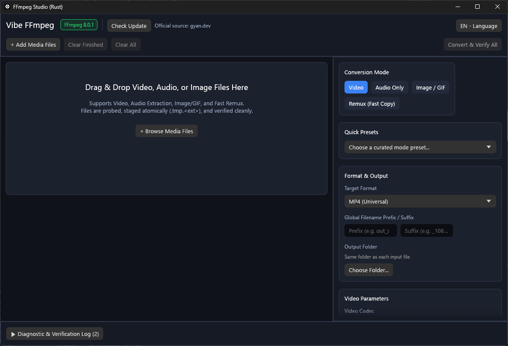

# Vibe FFmpeg ⚡

> **Built with AI Vibe Coding 🤖✨** — This project was created and iterated through AI-assisted vibe coding (prompt-driven engineering in Rust).
>
> Built purely to scratch my own itch and fit my personal workflow—open-sourced in case others find it useful too!

Lightweight, native multi-mode desktop GUI for FFmpeg written in Rust (`eframe` / `egui` 0.37 + `rfd` 0.18), engineered for speed, complete parameter generation, custom output naming, and mode-aware integrity verification.



## Quick Start

1. Make sure **`ffmpeg`** and **`ffprobe`** are available on your system **`PATH`** or placed in the **same folder** next to `ffmpeg-ui.exe` ([official Windows builds](https://www.gyan.dev/ffmpeg/builds/)).
2. Run `ffmpeg-ui.exe` (or build from source below).

## Features & Architecture

- **Multi-Mode Conversion (`ConvertMode`)**:
  - **Video**: `MP4`, `MKV`, `MOV`, `WebM` with software/hardware encoders (`libx264`, `libx265`, `libsvtav1`, `libvpx-vp9`, NVENC, AMF, QSV), speed presets, CRF/bitrate control, pixel format, scaling, FPS, and audio options (including Mute `-an`).
  - **Audio Only**: `MP3`, `FLAC`, `WAV`, `M4A (AAC)`, `Opus`, `OGG` with automatic `-vn` video stripping, bitrate, sample rate, and channel configuration.
  - **Image / GIF**: `GIF` (`palettegen` + `paletteuse`), `WebP` (static & animated `libwebp_anim`), `PNG`, `JPG`, and `AVIF` (`libaom-av1 -still-picture 1`) with FPS, aspect-preserving Max Width scaling, and quality/compression controls.
  - **Remux (Fast Copy)**: Container switching (`MP4`, `MKV`, `MOV`, `WebM`) using `-c copy` without re-encoding.
- **Custom Output Filenames & Collision Safety**:
  - Per-file editable output base name in the queue with auto-synced extension when switching formats, plus optional global Prefix/Suffix.
  - Automatic `_out` / `(N)` collision protection so an active input file is never overwritten in-place.
- **Atomic Staging & Mode-Aware Verification**:
  - Stages output to `.<stem>.<pid>_<id>.tmp.<ext>` with explicit `-f <muxer>` flags, verifies streams/duration via `ffprobe` + decode verification (`ffmpeg -v error -xerror -f null -` or `RIFF/WEBP` check for animated WebP) according to `ConvertMode`, and atomically commits only on success.
- **Official Update Check**: Queries `gyan.dev` release and git version endpoints over HTTPS (`ureq` + Windows `native-tls`).

## Modules

- `src/main.rs` — Window bootstrap and Windows GUI subsystem entry point.
- `src/app.rs` — App state, worker event dispatch, `rfd` multi-format file dialogs, and drag-and-drop handling.
- `src/models/` — `ConvertMode`, `ContainerFormat`, `ConversionSettings`, `PresetProfile`, `MediaInfo`, `QueuedFile`.
- `src/security/path_guard.rs` — Path canonicalization, filename sanitization, prefix/suffix composition, collision protection, and `.tmp.<ext>` staging.
- `src/ffmpeg/` — `discovery.rs`, `probe.rs`, `command_builder.rs`, `validator.rs`, `runner.rs`.
- `src/net/ffmpeg_update.rs` — HTTPS official FFmpeg update check.
- `src/i18n/` — 14-language localization tables with English fallback.
- `src/ui/` — `theme.rs`, `top_bar.rs`, `queue_panel.rs`, `settings_panel.rs`, `log_panel.rs`, `language_window.rs`.

## Build & Test

```powershell
$env:PATH = "$env:USERPROFILE\.cargo\bin;$env:PATH"
cargo test
cargo build --release
```
